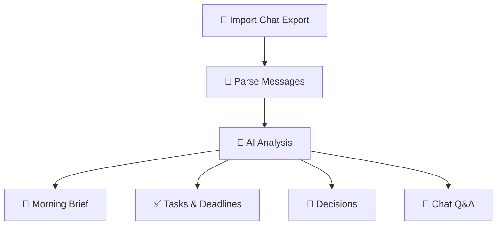

# 🦉 NightOwl AI

> Sleep through the noise. Wake up knowing what matters.

  

  

  <a href="https://hacktoberoctnightowl.netlify.app"><strong>🌐 Live Demo</strong></a> ·
  <a href="https://github.com/mitrasayak623-crypto/NightOwlshacktober"><strong>💻 GitHub Repository</strong></a>

---

## 🌙 What is NightOwl AI?

**NightOwl AI** is a group-chat intelligence assistant designed to help you catch up on long conversations without reading every message. It aims to turn noisy group chats into concise summaries, actionable tasks, important decisions, and unanswered questions.

> 🦉 **The mission:** Spend less time scrolling through messages and more time doing what matters.

## ✨ Features

| Feature | What it does |
|---|---|
| 🌅 Morning Brief | Get a concise summary of important updates. |
| ✅ Task Extraction | Identify action items, responsibilities, and deadlines. |
| 🎯 Decision Tracking | Find key decisions and changes of plan. |
| 💬 Ask Your Chats | Ask questions about conversations and find relevant messages. |
| 🔎 Unresolved Questions | Highlight possible follow-ups and unanswered requests. |
| 🔒 Privacy-First Vision | Designed with local processing as a core goal. |

> **Transparency note:** Features that require a genuine on-device AI model must be verified in the implementation. Demo data and planned functionality should not be mistaken for real AI inference.

## 🚀 Live Demo

Try the project: **https://hacktoberoctnightowl.netlify.app**

## 🧠 How It Works

The intended workflow is to import a supported chat export, parse its messages, analyze the conversation, and present useful insights. Genuine local inference requires a compatible on-device model runtime and verification that private chat content is not transmitted elsewhere.

## 🛠️ How It Was Built

NightOwl AI is a web-based prototype focused on a responsive interface and practical group-chat intelligence workflows. The project explores AI-assisted development and a future architecture for local chat processing.

The exact frameworks, model, and inference runtime should be documented here once verified from the source code.

## 🌍 Why Open Innovation Matters

- **Transparency:** Open code makes it easier to inspect and improve an application.
- **Collaboration:** Contributors can improve parsing, testing, accessibility, and reliability.
- **Model freedom:** Open-weight models can offer alternatives to closed AI APIs when their licenses and device requirements permit.
- **Privacy potential:** Local inference can reduce dependence on remote AI services when the complete data flow is implemented and verified.

## 🏆 Hacktoberfest Challenge

This project is a submission for the [Hacktoberfest Open-Source AI Challenge — Week 3: Slow and Steady](https://dev.to/challenges/hacktoberfest-week3-2026-10-19).

## 🤝 Contributing

Contributions and feedback are welcome!

1. Fork this repository.
2. Create a feature branch: `git checkout -b feature/your-feature`.
3. Make your changes and test them.
4. Commit your work: `git commit -m "Add your feature"`.
5. Push the branch and open a pull request.

Possible areas to improve include chat-export parsing, source evidence, testing, accessibility, task extraction, and on-device AI integration.

**Please never commit real private conversations, credentials, or API keys.**

## 🗺️ Roadmap

- [x] Publish the prototype and live demo
- [ ] Improve supported chat-export parsing
- [ ] Add evidence-backed task and decision extraction
- [ ] Integrate and test a genuine on-device AI runtime
- [ ] Verify offline processing and local data deletion
- [ ] Expand automated tests and documentation

## 👨‍💻 Creator

**Sayak Mitra**

- 🌐 Live app: https://hacktoberoctnightowl.netlify.app
- 💻 Repository: https://github.com/mitrasayak623-crypto/NightOwlshacktober

  

<i>Built with curiosity, creativity, and open-source spirit.</i>

